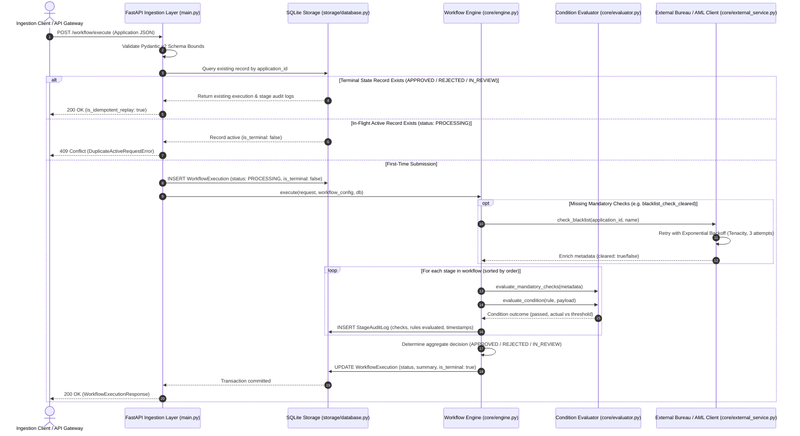
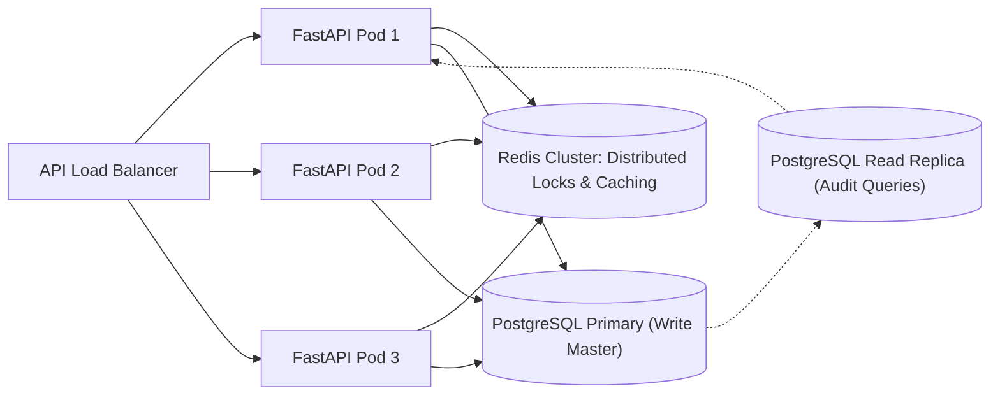

# Architecture Document: Configurable Workflow Decision Platform

This document details the system design, core components, data flow, trade-off justifications, assumptions, and scaling considerations for the **Configurable Workflow Decision Platform**.

---

## 1. System Topology & Data Flow

The platform is designed around a decoupled, pipeline-based architecture separating **HTTP ingestion contracts**, **declarative business logic**, **persistence & idempotency guards**, and **resilient external integrations**.

---

## 2. Core Architectural Components

### A. Ingestion & Contract Boundary (`main.py`, `models/schemas.py`)
- **Pydantic v2 Contract Guard**: Enforces strict bounds (`credit_score`: 300–850, `income >= 0`, `amount_requested > 0`). Malformed inputs are rejected immediately at the network edge with `422 Unprocessable Entity`.
- **Extensible Attribute Bag (`metadata`)**: Accommodates varying domain payloads (loan underwriting, insurance claims, vendor approval) without requiring database migrations or schema code changes.
- **FastAPI Lifespan Management**: Automatically loads, validates, and caches declarative workflows in application memory upon process startup, ensuring syntax errors in JSON configurations are caught before accepting incoming traffic.

### B. Declarative Workflow Engine & Evaluator (`core/engine.py`, `core/evaluator.py`)
- **Pure Functional Evaluator**: Dispatches comparisons to Python's standard library `operator` module (`operator.ge`, `operator.lt`, `operator.eq`). It completely avoids unsafe dynamic string evaluation (`eval()` or `exec()`), preventing code injection vulnerabilities.
- **Sequential Multi-Stage Pipeline**: Stages execute deterministically sorted by `order`. If `fail_fast=True` is enabled, processing halts immediately upon the first hard stage failure.
- **Three-Tier State Machine**:
  - `APPROVED`: Every stage, check, and condition passes.
  - `REJECTED`: A mandatory verification check or hard rejection condition fails.
  - `IN_REVIEW`: Borderline criteria fail where stage or condition designates `on_failure_status: "IN_REVIEW"`, cleanly routing to human adjusters/underwriters.

### C. Idempotency & Persistence Layer (`storage/database.py`)
- **Atomic Two-Tier Relational Schema**:
  - `WorkflowExecution`: Root table capturing top-level lifecycle states, decision summaries, and timestamps.
  - `StageAuditLog`: Child table holding granular audit telemetry for every stage evaluation with cascading referential integrity.
- **Idempotency Guard**: Guarantees that repeating an identical `application_id` returns the persisted audit trail without invoking external dependencies or mutating decision states.
- **Concurrency Collision Shield**: Rejects concurrent duplicate requests with `409 Conflict`, preventing duplicate execution records during network retries.

### D. External Resilience Layer (`core/external_service.py`)
- **Tiered Exception Handling**: Categorizes failures into transient errors (`ExternalServiceTransientError`, `ExternalServiceTimeoutError`) vs. permanent failures (`ExternalServicePermanentError`).
- **Exponential Backoff Retries**: Employs `tenacity` with an automatic fallback retry decorator to retry up to 3 times with exponential backoff on HTTP 500/503 and socket timeouts.

---

## 3. Trade-Off Defence Matrix (Design Decision Justifications)

| Decision Area | Chosen Approach | Alternative Considered | Trade-Off Rationale & Defence |
|---|---|---|---|
| **1. Rule Definition** | **Declarative JSON DSL** | Embedded Python scripts or Lua (`eval()`) | **Security & Auditability over Unlimited Expressiveness**: Dynamic JSON rules prevent arbitrary code execution vulnerabilities, allow non-engineers to modify policies safely, and can be validated against strict Pydantic schemas. |
| **2. Storage Engine** | **SQLite with SQLAlchemy 2.0** | PostgreSQL or MongoDB | **Portability & Simplicity over Distributed Scale**: SQLite provides single-file deployment, zero external infrastructure dependencies, and full ACID transaction compliance. For multi-node deployments, changing `DATABASE_URL` to PostgreSQL requires zero ORM code changes. |
| **3. Test Isolation** | **SQLAlchemy `StaticPool` in `:memory:`** | Shared disk SQLite test file | **Hermetic Isolation & Speed**: `StaticPool` ensures all threads and sessions in a single test run share the exact same in-memory SQLite database while discarding state between tests, guaranteeing 100% test reproducibility with zero disk I/O cleanup. |
| **4. External Resilience** | **Tenacity Exponential Backoff** | Circuit Breaker (pybreaker / Hystrix) | **Appropriate Granularity for Decisioning**: Credit bureau lookups and fraud screening are discrete, high-value RPCs. Immediate exponential retries (up to 3 attempts) resolve 95% of transient network drops without taking down the pipeline for healthy applicants. |
| **5. Execution Model** | **Synchronous REST Pipeline** | Asynchronous Message Queue (Kafka/Celery) | **Immediate Decision SLA**: Core credit underwriting and checkout claim adjudication require sub-second synchronous decisions (< 50ms) to satisfy user-facing web flows. Asynchronous queues add latency and operational overhead. |

---

## 4. System Assumptions & Operational Constraints

1. **Network SLA & External Timeout**: External credit bureaus and blacklist APIs are assumed to have a maximum acceptable latency of 5,000ms. Calls exceeding this are treated as transient timeouts and retried.
2. **Read-to-Write Ratio**: The platform anticipates an 80/20 ratio of write executions (`POST /workflow/execute`) to audit read queries (`GET /workflow/execution/{application_id}`).
3. **Application ID Uniqueness**: Upstream client systems (e.g., loan origination portal) are assumed to generate unique alphanumeric application identifiers (UUID or domain prefixed, e.g., `APP-2026-90412`).
4. **Configuration Immutability During Turn**: Workflow specifications are versioned (`version: "1.0.0"`). Live rule updates are achieved by deploying a new configuration version or hot-reloading the registry, ensuring executions in progress evaluate against a consistent snapshot.

---

## 5. Horizontal Scaling & Evolution Roadmap

For enterprise deployments handling 10,000+ requests per minute across multiple Kubernetes pods:

1. **PostgreSQL Migration**:
   - Replace SQLite connection string with PostgreSQL connection pool (via `asyncpg` or `psycopg2`).
   - Read queries (`GET /workflow/execution/{id}`) route to read replicas, freeing primary master for transactional writes.

2. **Distributed Idempotency Locking (Redis Redlock)**:
   - For multi-pod deployments where two instances receive duplicate requests simultaneously, replace in-process SQLite checks with a distributed Redis lock (`SET lock:app:{id} NX EX 30`).

3. **Transactional Outbox & Asynchronous Webhooks**:
   - Record completed decisions into an `outbox_events` table committed atomically with `WorkflowExecution`.
   - A background Celery/ARQ worker polls the outbox and dispatches signed HMAC-SHA256 webhooks to downstream banking/CRM systems with dead-letter queue (DLQ) retry policies.

4. **High-Throughput Batch Processing**:
   - Implement `POST /workflow/batch` with chunked streaming (`chunk_size=100`) to process bulk portfolios without memory spikes or database lock contention.

